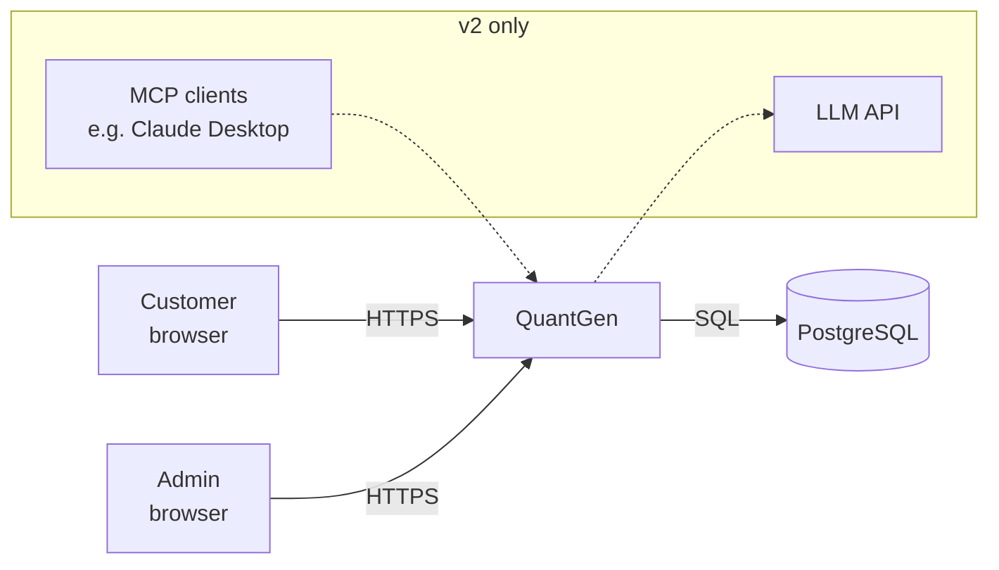
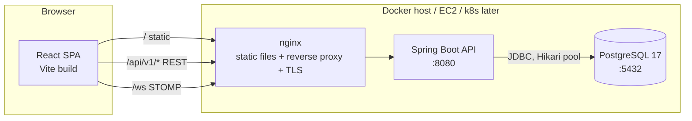
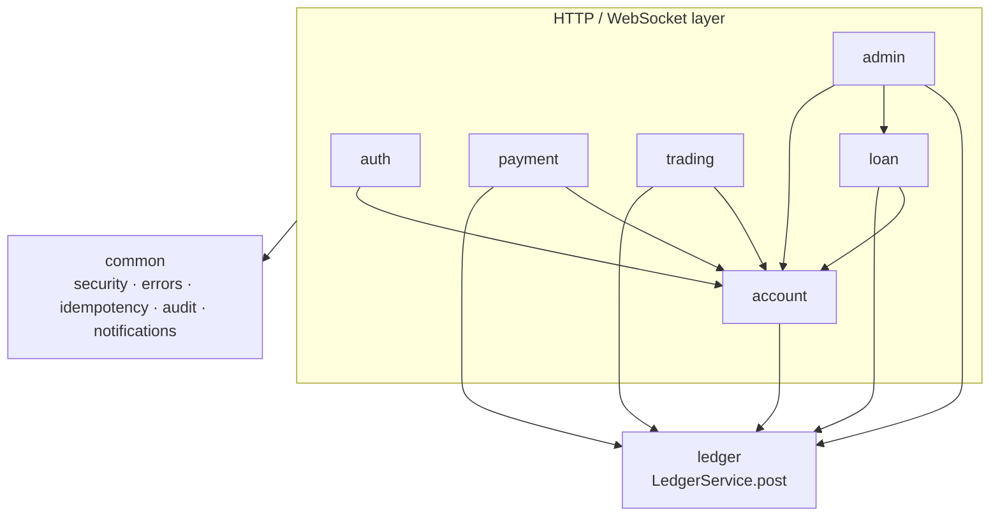
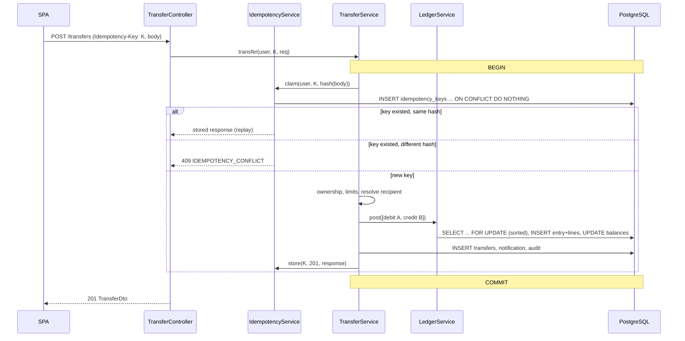
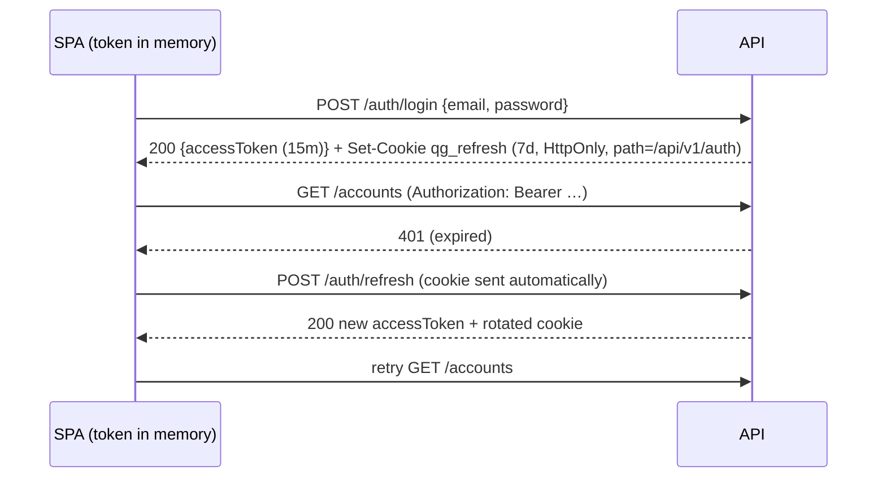
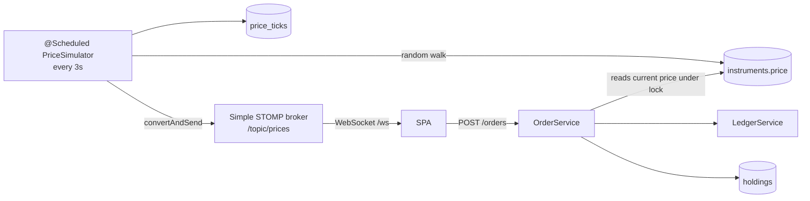
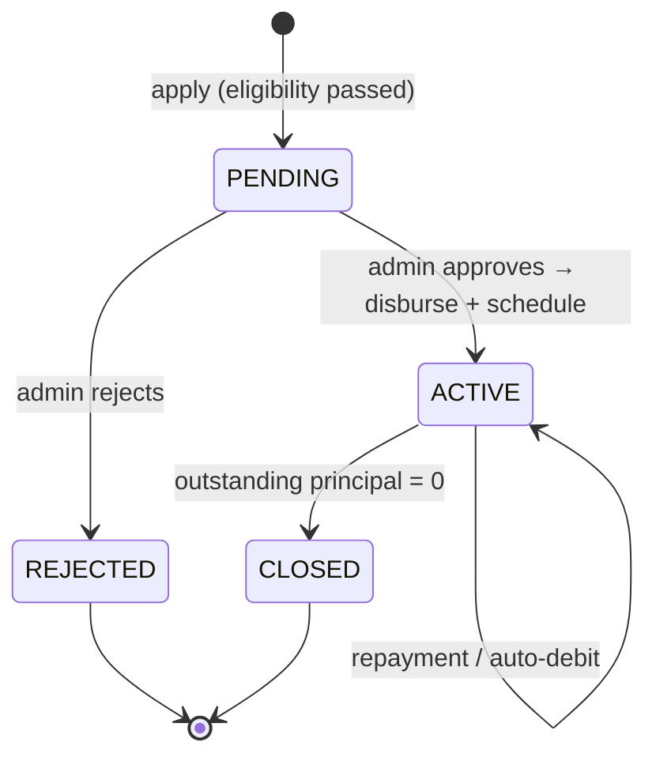
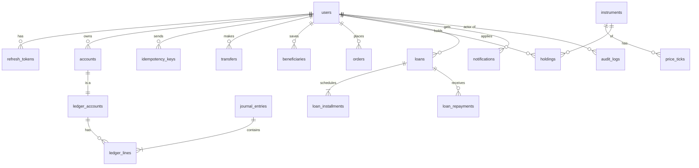

# QuantGen — Architecture

This document explains **how QuantGen is built and why**. Scope and the API contract live
in [`PRD.md`](PRD.md); engineering and security rules live in [`CLAUDE.md`](CLAUDE.md);
the visual design lives in [`frontend-quant/DESIGN.md`](frontend-quant/DESIGN.md).

---

## 1. System context


v1 has **no external dependencies** beyond PostgreSQL: funding and market prices are simulated
inside the system. This keeps the demo self-contained and free to run.

## 2. Containers (runtime units)



| Unit | Tech | Responsibility |
|---|---|---|
| **SPA** | React 19, TypeScript, Vite, TanStack Query | UI, client-side validation, holding the token in memory, live prices over WebSocket |
| **nginx** | nginx | Serves the SPA; proxies `/api` and `/ws` to the API so the browser sees a **single origin** (no CORS in prod); sets security headers (CSP, HSTS…) |
| **API** | Spring Boot (Java 25) | All business logic, auth, ledger, schedulers, WebSocket broker |
| **PostgreSQL** | PostgreSQL 17 | The only system of record |

**In dev**, the Vite dev server (`:5173`) does nginx's job by proxying `/api` and `/ws` to
`:8080`, and Postgres runs from [`docker-compose.dev.yml`](docker-compose.dev.yml) on host port **5433**.

## 3. Backend: modular monolith

One deployable, split into modules with hard boundaries.



**Rules**
- Each module has `api/` (controllers, DTOs), `service/` (interfaces and implementations) and `domain/` (entities, repositories).
- **A module calls another module only through its `service` interface.** It never imports another module's repository or entity. (This can be enforced later with Spring Modulith or ArchUnit.)
- **`ledger` is the only module that writes balances.** Everything that moves money builds a `JournalRequest` and calls `LedgerService.post()` inside its own `@Transactional` method, so the business record (transfer, order, loan) and the ledger entry commit or roll back together.

**Why a monolith?** The ledger needs single-database ACID transactions across banking,
trading and loans. Microservices would force sagas and eventual consistency onto the money
path. The module boundaries keep extraction possible later (§12).

### Request pipeline
```
Request
 → RequestIdFilter          (sets/echoes X-Request-Id, MDC)
 → RateLimitFilter          (Bucket4j, /auth/** only)
 → JwtAuthenticationFilter  (validates access token → SecurityContext)
 → Spring Security authz    (/admin/** needs ADMIN, everything else needs auth except /auth/*, /actuator/health, docs)
 → Controller               (@Valid DTOs)
 → Service                  (ownership checks, business rules, @Transactional)
 → LedgerService / repositories
 → GlobalExceptionHandler   (PRD §7.1 error body)
```

## 4. The ledger (core design)

### 4.1 Model
Every balance-bearing thing is a **ledger account**: each customer bank account plus the
system accounts below.

| System account | Normal side | Meaning |
|---|---|---|
| `BANK_CASH` | Debit (asset) | Money entering or leaving the bank from outside (demo deposits) |
| `LOAN_RECEIVABLE` | Debit (asset) | Principal customers owe the bank |
| `INTEREST_INCOME` | Credit (income) | Interest the bank has earned |
| `BROKERAGE_CLEARING` | Credit | Cash paid in for securities (net of sells) |

A customer account is **credit-normal**, because from the bank's view it's a liability: the
bank owes the customer that money. A credit increases the balance and a debit decreases it.

`journal_entries` (one per business event) has many `ledger_lines`
(`ledger_account_id, direction DEBIT|CREDIT, amount > 0`).

**Invariants**
1. For every entry, Σ debits = Σ credits.
2. Across the whole ledger, Σ debits = Σ credits (the reconcile check).
3. A customer account's balance is never below 0. System accounts may be.
4. `ledger_accounts.balance` (a cache) = Σ credits − Σ debits for credit-normal accounts (and the reverse for debit-normal).
5. Entries and lines are never updated or deleted.

### 4.2 Postings for each business event
| Event | Debit | Credit |
|---|---|---|
| Demo deposit ₹X | `BANK_CASH` X | Customer X |
| Transfer A → B ₹X | Customer A X | Customer B X |
| Buy N × P | Customer N·P | `BROKERAGE_CLEARING` N·P (+ holding row increases by N) |
| Sell N × P | `BROKERAGE_CLEARING` N·P | Customer N·P (+ holding row decreases by N) |
| Loan disbursal ₹X | `LOAN_RECEIVABLE` X | Customer X |
| EMI repayment (p + i) | Customer p+i | `LOAN_RECEIVABLE` p, `INTEREST_INCOME` i |
| Reversal of entry E | Mirror image of E's lines | (references E via `reverses_entry_id`) |

### 4.3 Posting algorithm (`LedgerService.post`)
```
@Transactional (joins caller's tx; isolation READ COMMITTED + explicit row locks)
1. validate: ≥2 lines, all amounts > 0 with scale ≤ 4, Σdebit == Σcredit
2. ids = distinct ledger_account_ids, sorted ascending
3. SELECT ... FROM ledger_accounts WHERE id IN (:ids) ORDER BY id FOR UPDATE
4. for each line: compute new balance; if customer account and new < 0 → INSUFFICIENT_FUNDS
   if account status FROZEN and line debits it → ACCOUNT_FROZEN
5. INSERT journal_entry, INSERT ledger_lines (with balance_after per line)
6. UPDATE ledger_accounts SET balance = new, version = version + 1
7. return entry
```
**Why pessimistic locks rather than SERIALIZABLE?** Locking in sorted order makes contention
predictable and deadlock-free, never asks the client to retry, and is easy to prove with a
concurrency test. `version` columns add an extra optimistic-lock safety net for cached data.

### 4.4 Transfer sequence (with idempotency)

If two requests with the same key race, the second one blocks on the unique index until the
first commits, then replays its stored response. Nothing is ever applied twice.

## 5. Authentication and session


- **Access token:** a JWT signed with HS256 carrying `sub=userId`, `role`, `exp`, `jti`. It's
  stateless, and it's **never persisted** in browser storage, which limits the blast radius of XSS.
- **Refresh tokens:** random 256-bit values, stored server-side **only as SHA-256 hashes**,
  with `family_id`. Each refresh revokes the old token and issues a new one in the same family.
  Presenting a revoked token **revokes the whole family**, which catches a stolen token.
- **On page reload,** the SPA calls `/auth/refresh` to get a fresh access token from the cookie.
- **CSRF:** the refresh cookie is `SameSite=Strict` and scoped to `/api/v1/auth`. Every other
  endpoint authenticates with the bearer header, which browsers never attach automatically.
- **Login lockout:** 5 failures in 15 minutes locks the account for 15 minutes. This is
  combined with per-IP rate limits.
- **Passwords:** hashed with BCrypt, cost 12.

## 6. Trading and real-time prices


- Market orders fill at the price read **inside the order's transaction**. The holding row
  is locked `FOR UPDATE` together with the ledger accounts.
- `holdings` keeps `quantity`, `avg_cost` (weighted) and `realized_pnl`. A sell realizes
  `(price − avg_cost) × qty`.
- `price_ticks` is pruned by a nightly job (keeping 7 days of 3-second ticks, then downsampling).
- The WebSocket CONNECT frame carries the JWT, which is validated in a `ChannelInterceptor`.
  `/topic/prices` is public data, but it is still authenticated.

## 7. Loans


- **EMI** = P·r·(1+r)^n / ((1+r)^n − 1), with r = annual rate / 12. Each instalment's
  interest = outstanding × r, rounded half-even to 2 decimal places, and the last instalment
  absorbs the rounding difference.
- **`EmiAutoDebitJob`** runs daily at 06:00 IST. For each `PENDING` instalment due today or
  earlier, it posts the repayment if funds allow, otherwise it marks the instalment `OVERDUE`
  and notifies the customer. Each instalment is processed in **its own transaction**, so one
  failure never blocks the others. A single-instance lock (an advisory lock / ShedLock later)
  prevents double runs.

## 8. Data model



Key columns and constraints (Flyway `V1__init.sql` is authoritative):
- All primary keys are `UUID` (`gen_random_uuid()`); all timestamps are `timestamptz` in UTC;
  money is `NUMERIC(19,4)`; quantities are `BIGINT`.
- `ledger_lines.amount CHECK (amount > 0)` · `accounts.account_number UNIQUE` ·
  `idempotency_keys UNIQUE (user_id, key)` · `holdings UNIQUE (user_id, symbol)` ·
  `refresh_tokens.token_hash UNIQUE`.
- Indexes: `ledger_lines (ledger_account_id, created_at DESC)` for history;
  `price_ticks (symbol, ts DESC)`; `loan_installments (status, due_date)` for the job;
  `audit_logs (created_at DESC)`.
- **Database-level guards:** a trigger that rejects `UPDATE`/`DELETE` on `journal_entries` and
  `ledger_lines`, plus a deferred constraint trigger that checks Σ debits = Σ credits per
  entry at commit. That's defence in depth on top of the Java checks.

## 9. Security architecture
| Layer | Control |
|---|---|
| Transport | TLS via nginx and Let's Encrypt; HSTS |
| Browser | Strict CSP (`default-src 'self'`), `X-Frame-Options: DENY`, `Referrer-Policy`, no inline scripts |
| Session | In-memory access JWT; HttpOnly SameSite=Strict refresh cookie with rotation and reuse detection |
| API | Deny by default; role and ownership checks in services; Bean Validation; standard error body; 404 for other users' resources |
| Abuse | Bucket4j rate limits on `/auth/**`; login lockout; per-transfer and daily limits |
| Data | Parameterized SQL only; BCrypt passwords; refresh tokens stored hashed; insert-only ledger with DB triggers; least-privilege DB user in prod |
| Audit | `audit_logs`: actor, action, target, IP, user agent, request id, and timestamp, for every sensitive action |
| Secrets | Env vars only; `.env.example` committed; prod secrets in the host/k8s secret store |
| Supply chain | Pinned versions; `npm audit` and OWASP Dependency-Check / Trivy in CI |

## 10. Observability
- **Logs:** JSON in prod (logstash encoder), with `requestId`, `userId` and `path` in MDC. Sensitive values are masked.
- **Health:** `/actuator/health` (liveness and readiness).
- **Metrics:** `/actuator/prometheus` (Micrometer). There are custom counters for transfers,
  orders, failed logins and ledger post latency. Prometheus and Grafana are added in v2.

## 11. Environments and deployment
| | Dev (now) | Prod v1 (M6) |
|---|---|---|
| Frontend | Vite dev server :5173 | Static build served by nginx container |
| Backend | `./mvnw spring-boot:run` (profile `dev`) | `backend-quant` Docker image (JRE 25, non-root) |
| DB | `docker-compose.dev.yml` → Postgres 17 on **localhost:5433** | Postgres container with a persistent volume (or RDS) |
| Orchestration | — | `docker-compose.yml` on EC2 / Oracle Cloud VM |
| CI/CD | — | GitHub Actions (build, test, scan, push image, deploy over SSH). Jenkins and ArgoCD come in v2 |
| Seed data | Demo users via `@Profile("dev")` | Demo user only (for the live demo) |

**Testing:** integration tests use **Testcontainers** (a throwaway Postgres 17 per test run),
so Docker must be running for `./mvnw verify`.

## 12. Evolution path (v2)
- **Events:** add a transactional **outbox** table written in the same transaction as each
  ledger post, then relay it to Redpanda. New services consume events and never touch the ledger DB.
- **Extracted services:** `agent-service` (LLM copilot, MCP server; it creates *intents*
  through the public API and never writes directly), `fraud-service` and
  `notification-service`. The core ledger stays in the monolith.
- **Ledger integrity:** each journal entry stores `prev_hash` and `hash`, forming a hash
  chain, plus a daily Merkle root.
- **Platform:** Kubernetes (kind / k3s), Helm, Jenkins CI, ArgoCD, Prometheus, Grafana,
  Loki and Tempo, Redis (idempotency cache, rate limits), k6 and Chaos Mesh.

## 13. Architecture decisions (ADR log)
| # | Decision | Why | Trade-off |
|---|---|---|---|
| 1 | Modular monolith | ACID across all money flows; one developer; cheap hosting | Must keep module discipline by hand |
| 2 | PostgreSQL | Real ACID, row locks, `NUMERIC`, constraints and triggers, JSONB, a mature ecosystem | Vertical scaling only (fine at this scale) |
| 3 | Double-entry ledger, insert-only | Auditability; mathematically checkable | More rows than a plain `balance` column |
| 4 | Pessimistic locks in sorted order | Deadlock-free and no client retries | Serializes writes to hot accounts |
| 5 | Idempotency keys stored in the DB, in the same transaction | Exactly-once effect even across crashes | One extra row per money request |
| 6 | Access token in memory + refresh cookie | Limits XSS token theft; CSRF-safe | A reload needs a refresh call |
| 7 | Simulated market and funding | Free, deterministic, no third-party keys | Not real market data |
| 8 | Money as JSON strings | No floating-point loss anywhere | The client needs a decimal library |
| 9 | Postgres in Docker on :5433 for dev | Matches prod and Testcontainers; no clash with the local PG 18 service | Docker Desktop must be running |
