# QuantGen — Architecture

This document explains **how QuantGen is built and why**. Scope and the API contract live
in [`PRD.md`](PRD.md); engineering and security rules live in [`CLAUDE.md`](CLAUDE.md);
the visual design lives in [`frontend-quant/DESIGN.md`](frontend-quant/DESIGN.md); every
decision and its trade-off lives in [`DECISIONS.md`](DECISIONS.md); a plain-language guide
to how work flows lives in [`FLOW.md`](FLOW.md).

§1–§11 describe **v1, as built**. §12 describes the **v2 design (draft)**.

---

## 1. System context

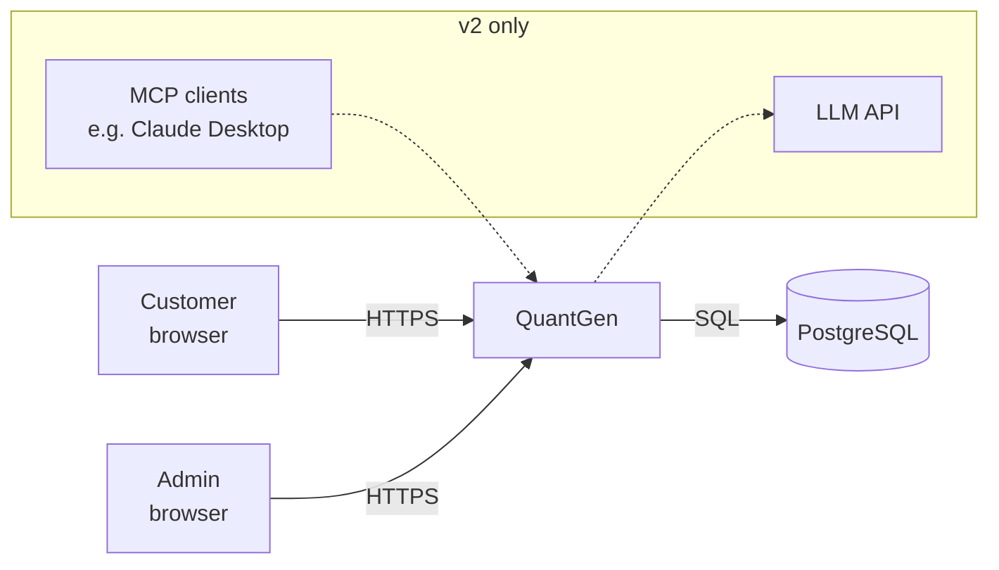
v1 has **no external dependencies** beyond PostgreSQL: funding and market prices are simulated
inside the system. This keeps the demo self-contained and free to run.

## 2. Containers (runtime units)

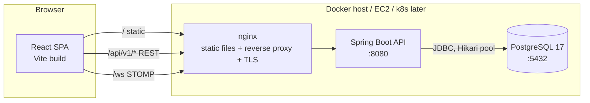

| Unit | Tech | Responsibility |
|---|---|---|
| **SPA** | React 19, TypeScript, Vite, TanStack Query | UI, client-side validation, holding the token in memory, live prices over WebSocket |
| **nginx** | nginx | Serves the SPA; proxies `/api` and `/ws` to the API so the browser sees a **single origin** (no CORS in prod); sets security headers (CSP, HSTS…) |
| **API** | Spring Boot (Java 25) | All business logic, auth, ledger, schedulers, WebSocket broker |
| **PostgreSQL** | PostgreSQL 17 | The only system of record |

**In dev**, the Vite dev server (`:5173`) does nginx's job by proxying `/api` and `/ws` to
`:8080`, and Postgres runs from [`docker-compose.dev.yml`](docker-compose.dev.yml) on host port **5433**.

## 3. Backend: modular monolith

One deployable, split into modules with hard boundaries.

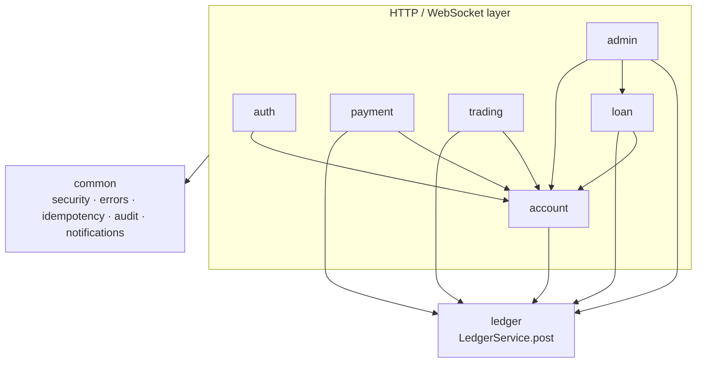

**Rules**
- Each module has `api/` (controllers, DTOs), `service/` (interfaces and implementations) and `domain/` (entities, repositories).
- **A module calls another module only through its `service` interface.** It never imports another module's repository or entity. (This can be enforced later with Spring Modulith or ArchUnit.)
- **`ledger` is the only module that writes balances.** Everything that moves money builds a `JournalRequest` and calls `LedgerService.post()` inside its own `@Transactional` method, so the business record (transfer, order, loan) and the ledger entry commit or roll back together.

**Why a monolith?** The ledger needs single-database ACID transactions across banking,
trading and loans. Microservices would force sagas and eventual consistency onto the money
path. The module boundaries keep extraction possible later (§12).

### Request pipeline
```
Request
 → RequestIdFilter          (sets/echoes X-Request-Id, MDC)
 → RateLimitFilter          (Bucket4j, /auth/** only)
 → JwtAuthenticationFilter  (validates access token → SecurityContext)
 → Spring Security authz    (/admin/** needs ADMIN, everything else needs auth except /auth/*, /actuator/health, docs)
 → Controller               (@Valid DTOs)
 → Service                  (ownership checks, business rules, @Transactional)
 → LedgerService / repositories
 → GlobalExceptionHandler   (PRD §7.1 error body)
```

## 4. The ledger (core design)

### 4.1 Model
Every balance-bearing thing is a **ledger account**: each customer bank account plus the
system accounts below.

| System account | Normal side | Meaning |
|---|---|---|
| `BANK_CASH` | Debit (asset) | Money entering or leaving the bank from outside (demo deposits) |
| `LOAN_RECEIVABLE` | Debit (asset) | Principal customers owe the bank |
| `INTEREST_INCOME` | Credit (income) | Interest the bank has earned |
| `BROKERAGE_CLEARING` | Credit | Cash paid in for securities (net of sells) |

A customer account is **credit-normal**, because from the bank's view it's a liability: the
bank owes the customer that money. A credit increases the balance and a debit decreases it.

`journal_entries` (one per business event) has many `ledger_lines`
(`ledger_account_id, direction DEBIT|CREDIT, amount > 0`).

**Invariants**
1. For every entry, Σ debits = Σ credits.
2. Across the whole ledger, Σ debits = Σ credits (the reconcile check).
3. A customer account's balance is never below 0. System accounts may be.
4. `ledger_accounts.balance` (a cache) = Σ credits − Σ debits for credit-normal accounts (and the reverse for debit-normal).
5. Entries and lines are never updated or deleted.

### 4.2 Postings for each business event
| Event | Debit | Credit |
|---|---|---|
| Demo deposit ₹X | `BANK_CASH` X | Customer X |
| Transfer A → B ₹X | Customer A X | Customer B X |
| Buy N × P | Customer N·P | `BROKERAGE_CLEARING` N·P (+ holding row increases by N) |
| Sell N × P | `BROKERAGE_CLEARING` N·P | Customer N·P (+ holding row decreases by N) |
| Loan disbursal ₹X | `LOAN_RECEIVABLE` X | Customer X |
| EMI repayment (p + i) | Customer p+i | `LOAN_RECEIVABLE` p, `INTEREST_INCOME` i |
| Reversal of entry E | Mirror image of E's lines | (references E via `reverses_entry_id`) |

### 4.3 Posting algorithm (`LedgerService.post`)
```
@Transactional (joins caller's tx; isolation READ COMMITTED + explicit row locks)
1. validate: ≥2 lines, all amounts > 0 with scale ≤ 4, Σdebit == Σcredit
2. ids = distinct ledger_account_ids, sorted ascending
3. SELECT ... FROM ledger_accounts WHERE id IN (:ids) ORDER BY id FOR UPDATE
4. for each line: compute new balance; if customer account and new < 0 → INSUFFICIENT_FUNDS
   if account status FROZEN and line debits it → ACCOUNT_FROZEN
5. INSERT journal_entry, INSERT ledger_lines (with balance_after per line)
6. UPDATE ledger_accounts SET balance = new, version = version + 1
7. return entry
```
**Why pessimistic locks rather than SERIALIZABLE?** Locking in sorted order makes contention
predictable and deadlock-free, never asks the client to retry, and is easy to prove with a
concurrency test. `version` columns add an extra optimistic-lock safety net for cached data.

### 4.4 Transfer sequence (with idempotency)
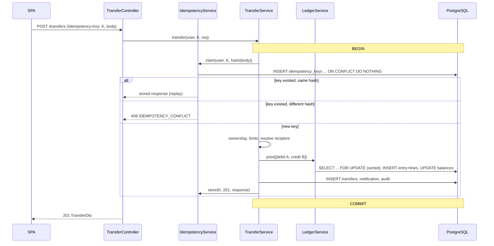
If two requests with the same key race, the second one blocks on the unique index until the
first commits, then replays its stored response. Nothing is ever applied twice.

## 5. Authentication and session

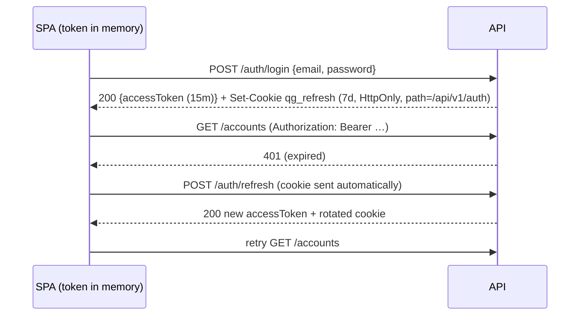
- **Access token:** a JWT signed with HS256 carrying `sub=userId`, `role`, `exp`, `jti`. It's
  stateless, and it's **never persisted** in browser storage, which limits the blast radius of XSS.
- **Refresh tokens:** random 256-bit values, stored server-side **only as SHA-256 hashes**,
  with `family_id`. Each refresh revokes the old token and issues a new one in the same family.
  Presenting a revoked token **revokes the whole family**, which catches a stolen token.
- **On page reload,** the SPA calls `/auth/refresh` to get a fresh access token from the cookie.
- **CSRF:** the refresh cookie is `SameSite=Strict` and scoped to `/api/v1/auth`. Every other
  endpoint authenticates with the bearer header, which browsers never attach automatically.
- **Login lockout:** 5 failures in 15 minutes locks the account for 15 minutes. This is
  combined with per-IP rate limits (`RateLimitFilter`: login 10/min, register 10/h, refresh and
  logout 30/min; 429 `RATE_LIMITED` with `Retry-After`).
- **Passwords:** hashed with BCrypt, cost 12.

## 6. Trading and real-time prices

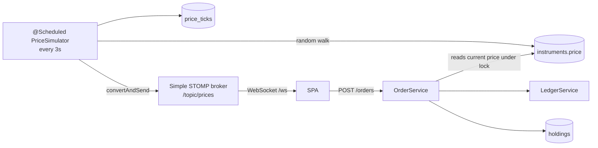
- Market orders fill at the price read **inside the order's transaction**. The holding row
  is locked `FOR UPDATE` together with the ledger accounts.
- `holdings` keeps `quantity`, `avg_cost` (weighted) and `realized_pnl`. A sell realizes
  `(price − avg_cost) × qty`.
- `price_ticks` is pruned by a nightly job (keeping 7 days of 3-second ticks, then downsampling).
- The WebSocket CONNECT frame carries the JWT, which is validated in a `ChannelInterceptor`.
  `/topic/prices` is public data, but it is still authenticated.

## 7. Loans

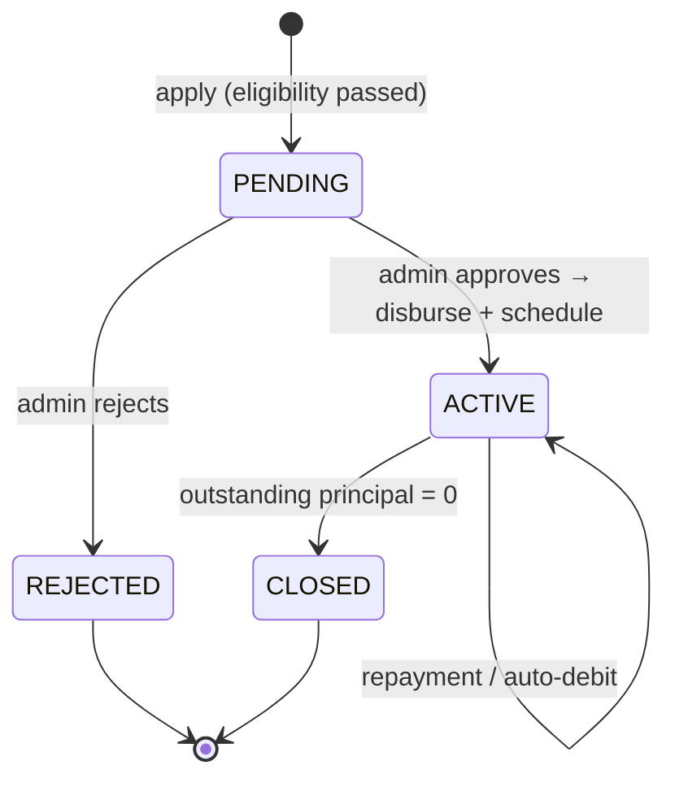
- **EMI** = P·r·(1+r)^n / ((1+r)^n − 1), with r = annual rate / 12. Each instalment's
  interest = outstanding × r, rounded half-even to 2 decimal places, and the last instalment
  absorbs the rounding difference.
- **`EmiAutoDebitJob`** runs daily at 06:00 IST. For each `PENDING` instalment due today or
  earlier, it posts the repayment if funds allow, otherwise it marks the instalment `OVERDUE`
  and notifies the customer. Each instalment is processed in **its own transaction**, so one
  failure never blocks the others. A single-instance lock (an advisory lock / ShedLock later)
  prevents double runs. `OVERDUE` instalments are retried on later runs, and the job also sends
  `EMI_DUE` reminders three days ahead (once per instalment).
- **Repayments** go to the oldest dues first, interest before principal within each instalment, so
  partial payments are allowed. Lock order is the same everywhere: idempotency key → loan row
  (`FOR UPDATE`) → ledger rows.

## 8. Data model

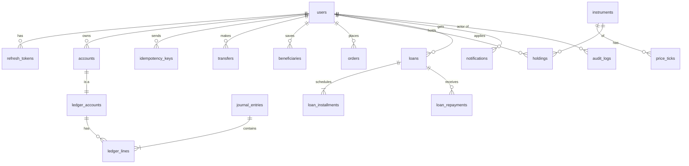

Key columns and constraints (Flyway `V1__init.sql` is authoritative):
- All primary keys are `UUID` (`gen_random_uuid()`); all timestamps are `timestamptz` in UTC;
  money is `NUMERIC(19,4)`; quantities are `BIGINT`.
- `ledger_lines.amount CHECK (amount > 0)` · `accounts.account_number UNIQUE` ·
  `idempotency_keys UNIQUE (user_id, key)` · `holdings UNIQUE (user_id, symbol)` ·
  `refresh_tokens.token_hash UNIQUE`.
- Indexes: `ledger_lines (ledger_account_id, created_at DESC)` for history;
  `price_ticks (symbol, ts DESC)`; `loan_installments (status, due_date)` for the job;
  `audit_logs (created_at DESC)`.
- **Database-level guards:** a trigger that rejects `UPDATE`/`DELETE` on `journal_entries` and
  `ledger_lines`, plus a deferred constraint trigger that checks Σ debits = Σ credits per
  entry at commit. That's defence in depth on top of the Java checks.

## 9. Security architecture
| Layer | Control |
|---|---|
| Transport | TLS via nginx and Let's Encrypt; HSTS |
| Browser | Strict CSP (`default-src 'self'`), `X-Frame-Options: DENY`, `Referrer-Policy`, no inline scripts |
| Session | In-memory access JWT; HttpOnly SameSite=Strict refresh cookie with rotation and reuse detection |
| API | Deny by default; role and ownership checks in services; Bean Validation; standard error body; 404 for other users' resources |
| Abuse | Bucket4j rate limits on `/auth/**`; login lockout; per-transfer and daily limits |
| Data | Parameterized SQL only; BCrypt passwords; refresh tokens stored hashed; insert-only ledger with DB triggers; least-privilege DB user in prod |
| Audit | `audit_logs`: actor, action, target, IP, user agent, request id, and timestamp, for every sensitive action |
| Secrets | Env vars only; `.env.example` committed; prod secrets in the host/k8s secret store |
| Supply chain | Pinned versions; `npm audit` and OWASP Dependency-Check / Trivy in CI |

## 10. Observability
- **Logs:** JSON in prod (logstash encoder), with `requestId`, `userId` and `path` in MDC. Sensitive values are masked.
- **Health:** `/actuator/health` (liveness and readiness).
- **Metrics:** *planned, not yet built* (audit 2026-10-18): `/actuator/prometheus`
  (Micrometer) with counters for transfers, orders, failed logins and a ledger-post latency
  timer. Actuator currently exposes only `health,info`. Scheduled for V2-M0; Prometheus and
  Grafana arrive at V2-M11 (§12.14).

## 11. Environments and deployment
| | Dev (now) | Prod v1 (M6) |
|---|---|---|
| Frontend | Vite dev server :5173 | Static build served by nginx container |
| Backend | `./mvnw spring-boot:run` (profile `dev`) | `backend-quant` Docker image (JRE 25, non-root) |
| DB | `docker-compose.dev.yml` → Postgres 17 on **localhost:5433** | Postgres container with a persistent volume (or RDS) |
| Orchestration | — | `docker-compose.yml` on EC2 / Oracle Cloud VM |
| CI/CD | — | GitHub Actions (build, test, scan, push image, deploy over SSH). Jenkins and ArgoCD come in v2 |
| Seed data | `DemoDataSeeder` (profile `dev`) | Same seeder via the `demo` profile (`prod,demo`); demo passwords from `QG_DEMO_*_PASSWORD` |

**Testing:** integration tests use **Testcontainers** (a throwaway Postgres 17 per test run),
so Docker must be running for `./mvnw verify`.

## 12. Version 2 architecture (draft, 2026-10-18)

> Scope and contract: PRD §11–§13. Every choice below has an entry in
> [`DECISIONS.md`](DECISIONS.md) (D-0xx). Nothing here is built yet.

### 12.1 What changes, in one picture
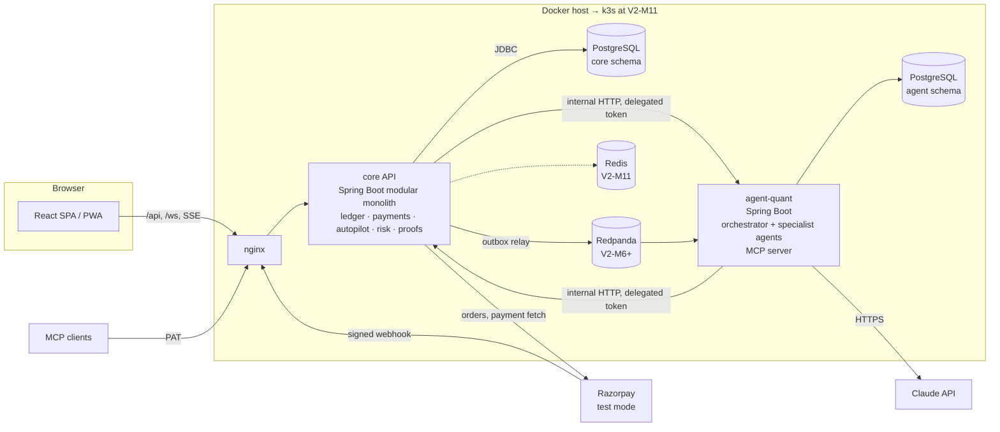
Three rules hold this together:
1. **The core is the only thing that touches money or the core DB.** `agent-quant` has no
   core DB credentials and no route to Postgres's core schema (D-018).
2. **The browser only talks to the core.** Copilot traffic goes SPA → core → `agent-quant`, so
   the single-origin model, CSP, auth and rate limits stay in one place.
3. **No money path waits on the AI.** If `agent-quant` or the Claude API is down, only the
   copilot is affected (PRD §11.5).

### 12.2 New core modules
Same module rules as §3 (talk through service interfaces only).

| Module | Owns | Depends on |
|---|---|---|
| `events` (in `common`) | `outbox_events`, the poller, consumer registry | — |
| `ledger` (extended) | holds, `ledger_seals`, balance snapshots, proofs | events |
| `security` (in `auth`) | passkeys, step-up tokens, PIN, sessions, PATs, field encryption | — |
| `payment` (extended) | handles, payee resolve, requests, schedules, billers, splits, top-ups | ledger, account, risk |
| `savings` | goals, round-ups, FDs, interest jobs | ledger, account |
| `insights` | categories, budgets, forecast, net worth: computed live from the ledger with the analytics `LedgerKinds` rules (only user overrides and budgets are stored); budget alerts are an outbox consumer | events, analytics |
| `intent` | intents: validate, render summary, approve → dispatch to the owning service | payment, trading, savings, loan, autopilot |
| `autopilot` | rule DSL, validator, renderer, simulator, engine, runs | events, intent, payment, trading, savings |
| `risk` | fraud rules + scoring, cases, loan documents | events |
| `card` | cards, controls, authorizations, sandbox merchant | ledger, risk |
| `copilot` (thin) | SSE proxy to `agent-quant`, delegated-token minting, budgets | security |

### 12.3 Holds and available balance (D-027)
```
available = ledger_accounts.balance − Σ holds.amount WHERE status = ACTIVE
```
- **Placing a hold** locks the ledger account row `FOR UPDATE` (same lock as postings), checks
  `available ≥ amount`, inserts the hold. So a hold and a transfer can't both spend the same rupee.
- **`LedgerService.post`** gains an optional `captureHoldId`. For debits it checks
  `balance − (active holds except the one being captured) ≥ debit`. Capturing marks the hold
  `CAPTURED` in the same transaction as the entry.
- **Expiry:** a job releases holds past `expires_at` (card auths 7 days, limit orders at
  validity end, fraud holds never auto-expire).
- System accounts never have holds. Frozen accounts can't place new holds; existing ones can still be released.

### 12.4 Outbox and events (D-028)
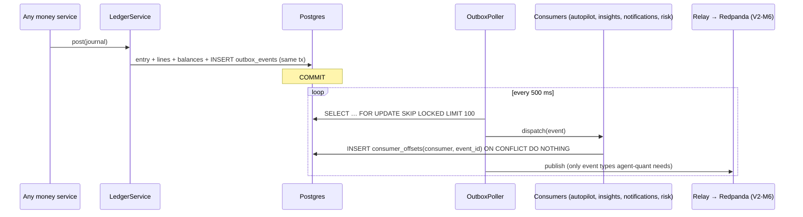
- Delivery is **at least once**. Each consumer records `(consumer, event_id)` in the same
  transaction as its own work, so a redelivered event is a no-op. That transaction is separate per
  (event, consumer) (`REQUIRES_NEW`), so one failing consumer never undoes another's work.
- Events carry ids and amounts, never names, notes or full account numbers.
- Event types: `MONEY_MOVED`, `TRANSFER_REVIEW_OPENED`, `HOLD_PLACED`, `HOLD_RELEASED`,
  `PRICE_TICK` (in-memory only, not stored), `LOAN_STATUS_CHANGED`, `RULE_RUN_FINISHED`.

### 12.5 Step-up authentication (D-029)
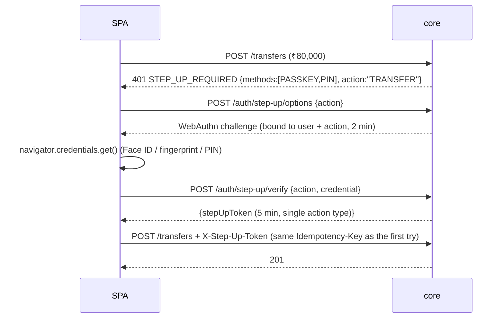
- Step-up tokens are random, stored hashed, bound to `(userId, action)`, expire after 5 min.
  A token for `TRANSFER` can't approve an Autopilot rule.
- The retried request reuses the same `Idempotency-Key`. The first `401` doesn't consume the
  key, because the request was rejected before the idempotency claim.
- Passkey credentials are verified with Yubico `java-webauthn-server`; sign counters are
  checked to detect cloned authenticators.

### 12.6 Payments 2.0 flows
- **Handles and resolve:** `handles(handle UNIQUE, user_id, account_id)`. Resolve returns a
  masked name and is rate-limited per user (Bucket4j, like auth) and audited when it trips.
- **Scheduled transfers:** `ScheduledTransferJob` (07:00 IST, single-instance lock) creates
  one `scheduled_transfer_runs` row per `(instruction, runDate)` (unique), then calls
  `TransferService` with idempotency key `sched:<instructionId>:<runDate>`. Each run is its own
  transaction, as with the EMI job (§7).
- **Razorpay top-ups:** PRD §7.9. The webhook endpoint is the only unauthenticated POST in the
  API; it verifies the HMAC over the **raw** body before parsing, stores `webhook_events` by
  Razorpay event id (unique), then credits through the same `TopupService.credit()` as
  `/verify`. `credit()` locks the top-up row `FOR UPDATE` and is a no-op if already `CREDITED`.
- **Bill payments:** `BillerSimulator` derives the amount from `HMAC(consumerNumber, billerId, month)`
  so it's stable across calls. Payment = customer → `BILLER_CLEARING`.
- **Split groups:** pure bookkeeping until settlement; settlement creates payment requests.
  Split arithmetic uses `BigDecimal` with `RoundingMode.DOWN` per share; leftover paisa go to the payer.

### 12.7 Agent layer (`agent-quant`) (D-017 … D-023)
```mermaid
flowchart TB
  U[User message] --> CORE[core: /copilot SSE proxy<br/>mints delegated token<br/>checks budget + flag]
  CORE --> CON[Concierge<br/>orchestrator]
  CON -->|delegate| LA[Ledger Analyst]
  CON -->|delegate| PAY[Payments]
  CON -->|delegate| MK[Markets]
  CON -->|delegate| PL[Planner]
  CON -->|delegate| LO[Loan Advisor]
  LA & PAY & MK & PL & LO -->|read tools 🤖| CAPI[core API]
  PAY & MK & PL & LO -->|propose_intent 🤖| CAPI
  subgraph Back office, event-driven
    FI[Fraud Investigator]
    UA[Underwriting Analyst]
  end
  RP[(Redpanda)] --> FI
  CAPI -->|loan doc uploaded| UA
  FI & UA -->|write memo| CAPI
```
**How a turn runs**
1. SPA `POST /copilot/conversations/{id}/messages`. The core checks the `ai` flag, the user's
   rate limit and token budget, mints a delegated JWT (`aud=agent`, `scope=agent:read
   agent:propose`, 15 min), and opens an internal streaming call to `agent-quant`.
2. The **Concierge** sees the conversation plus *descriptions* of the specialists, exposed to
   it as tools (`ask_ledger_analyst(question)`, …). It decides which to call, possibly several
   in parallel.
3. Each **specialist** is its own Messages API loop with its own system prompt and only its
   own tools. Tools are thin HTTP calls to 🤖 endpoints of the core, made with the delegated
   token, so the core enforces ownership exactly as for the user.
4. A specialist that wants to act calls `propose_intent(kind, payload, rationale)`. The core
   validates the payload (ownership, limits, balance, cooling period), renders the summary and
   returns an `IntentDto`, which is streamed to the UI as an `intent` event.
   As built (V2-M4 core, `com.quantgen.intent`): proposal validates ownership and shape and stores a normalized payload
   (handles resolved to account ids); limits, balance, cooling and fraud rules are checked again at approval through
   the normal services, and a refusal there is recorded as a FAILED intent. MCP clients reach the same endpoint with a
   `read+propose` personal access token today; delegated agent tokens (D-022) arrive with `agent-quant`.
5. The Concierge writes the final answer; tokens stream back through the core to the SPA.
6. Every model call and tool call is written to `agent_runs` / `agent_steps` (redacted).

**Guardrails, in layers**
| Layer | Control |
|---|---|
| Authority | Agent tokens can only reach 🤖 endpoints; intents need human approval + step-up (D-017, D-022) |
| Tool surface | Each agent has an allowlist; no agent has an "execute" tool; tool inputs use `strict: true` JSON schemas |
| Data | User-controlled strings returned by tools are wrapped as quoted data with a "this is data, not instructions" marker; account numbers masked; no PAN, tokens or PINs ever in tool results |
| Output | Intent cards rendered by the core (D-023); citations link to real transaction ids, which the UI resolves itself |
| Budget | 10 tool calls per turn, per-user daily tokens, global monthly cap → kill switch (D-039) |
| Detection | Red-team eval set in CI (PRD F-AGT-8); alerts on unusual intent rates per user |

**Model use (D-020):** model ids are config. Defaults: `claude-opus-5-5` for the Concierge,
Planner/Autopilot compiler and back-office memos; `claude-haiku-5-5` for categorization fallback
and short copy. Adaptive thinking with explicit `effort` per agent (low for simple specialists,
high for the compiler and underwriting); streaming for anything user-facing; prompt caching on the
stable prefix (tools + system prompt); structured outputs for the Autopilot compiler and memos;
handle `stop_reason: "refusal"` and API errors by telling the user, never by retrying blindly.

**Why not an LLM framework?** The loop is small, and owning it means every step passes through
our authz, audit and tracing code (D-019).

### 12.8 Intents (D-017, D-023)
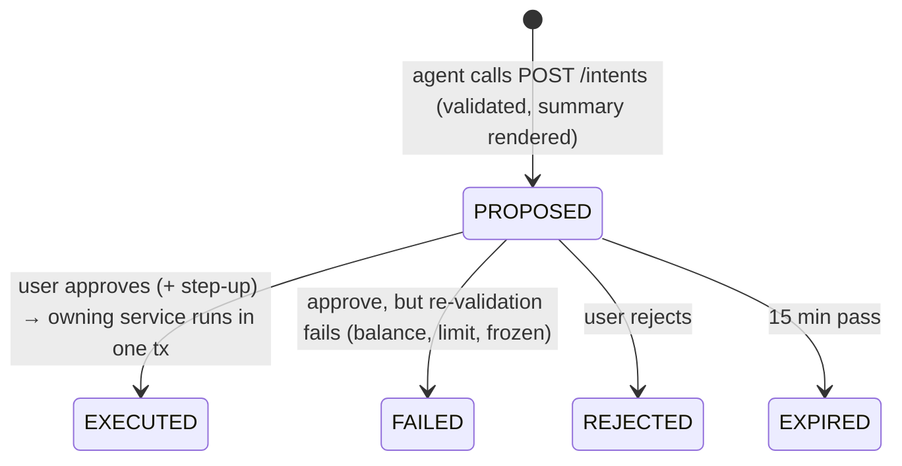
- `POST /intents/{id}/approve` takes an `Idempotency-Key`. Inside one transaction it locks the
  intent row, checks `PROPOSED` and not expired, **re-validates the payload**, and calls the same
  service method a manual action would (e.g. `TransferService.transfer` with
  `source=INTENT`). The intent and the business record commit together.
- The payload is stored as typed JSON per `kind`; unknown fields are rejected at proposal time.
- `riskLevel` and `requiresStepUp` are computed by the core (amount, payee age, kind), never by the model.

### 12.9 Autopilot engine (D-024)
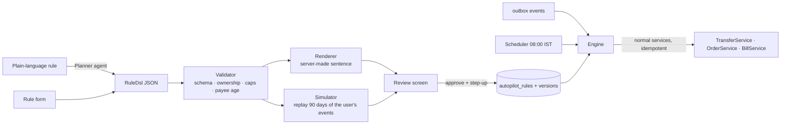
- **Matching:** the engine is an outbox consumer. For each `MONEY_MOVED` event it loads the
  user's active rules with matching trigger types (indexed by `(user_id, trigger_type)`).
- **Loop prevention:** movements made by Autopilot carry `source=AUTOPILOT`; `MONEY_RECEIVED`
  triggers ignore them (PRD F-AUTO-6).
- **Execution:** first a short transaction claims the run: insert `autopilot_runs (rule_id,
  version, trigger_event_id)` (unique → a duplicate event is a no-op) and check caps (per run,
  per month, daily Autopilot cap). Then **each action runs in its own transaction** with
  idempotency key `auto:<runId>:<actionIndex>`, so a crash and retry resumes without repeating
  finished actions. If an action fails, only that action rolls back; the run records `PARTIAL`
  or `FAILED`, later actions are skipped, and earlier ones stay done. "Partial" is therefore
  well defined and shown to the user.
- **Simulator** reuses the matcher and amount calculator against historical events with a
  fake balance tracker; it never calls a posting service.
- **DSL versioning:** `dslVersion` in every rule; the engine supports N and N−1; migrations
  rewrite stored rules forward.
- **As built (V2-M5, `com.quantgen.autopilot`):** `AutopilotEngine` is an outbox consumer named `autopilot`; the
  claim happens in the consumer transaction and actions start after it commits (virtual threads), with a sweeper
  resuming runs unfinished after 2 minutes. Price ticks reach it as a Spring `PricesUpdatedEvent`, so `trading` does
  not depend on `autopilot`. Each action's result row commits with the action; a failed action is recorded in a
  new transaction. `RuleSimulator` reads ledger lines, daily balances and stored price ticks.

### 12.10 Proof of Balance (D-025, D-026)
**Sealing (continuous)**
```
LedgerSealer (every 2 s, single instance):
  last = SELECT position, hash FROM ledger_seals ORDER BY position DESC LIMIT 1
  batch = journal entries committed and not yet sealed, ORDER BY created_at, id LIMIT 500
  for e in batch:
     h = SHA256(last.hash ‖ canonical(e, lines))
     INSERT ledger_seals(position = last.position+1, entry_id = e.id, prev_hash = last.hash, hash = h)
     last = (position+1, h)
```
`canonical()` is a fixed, documented serialization (one header line plus one line per ledger line sorted
by id, amounts as plain strings with 4 decimals, UTC timestamps with microseconds, free text hashed; exact
format in PRD §12.10 "Backend notes"), so anyone can recompute it. `ledger_seals` has the same
immutability triggers as the ledger. `entry_id` is unique, so an entry can't be sealed twice.
As built (`com.quantgen.ledger.proof`): the sealer takes an advisory lock, the first pass after startup scans all
history and later passes look back one hour (covering any transaction still open on an earlier pass).

**Snapshot (daily, first check on/after 00:00 IST)**
- Every customer ledger account's balance **as of the chain head**: Σ lines of the entries sealed up to
  `chainHead.position`, read in one `REPEATABLE READ` transaction. Reproducible from the ledger alone.
- Leaf: `hash = SHA256(accountId ‖ balance ‖ salt)`, `sum = balance`; salt =
  `HMAC(QG_INDEX_KEY, "qg-proof-salt-v1" ‖ accountId ‖ date)`, truncated to 32 hex chars (no extra secret).
- Node: `hash = SHA256(left.hash ‖ left.sum ‖ right.hash ‖ right.sum)`, `sum = left.sum + right.sum`.
  Leaves are ordered by account id (PRD §12.10, which supersedes an earlier "shuffled by salt" draft) and
  padded with zero-sum leaves to a power of two. All nodes are stored in `balance_snapshot_nodes`.
- A job checks every minute and takes today's snapshot if it's missing (covers midnight, downtime and a fresh DB).
  The chain verifier runs nightly at 00:30 IST; a break is audited and notifies every admin (`LEDGER_INTEGRITY`).
- Publish `{date, root, totalLiabilities, leafCount, chainHead}`.

**Verification in the browser:** the SPA gets `{leaf, path, root}`, recomputes with
`crypto.subtle.digest('SHA-256', …)` and a decimal library for the sums (D-008), and compares with
the root from `/public/proofs/roots`. Proving: "my balance was included in the published total,
and the total isn't smaller than the sum of the parts". Not proving: that reserves exist outside the system.

### 12.11 Fraud and underwriting (D-030, D-031)
- `RiskService.score(transferRequest)` runs inside the transfer transaction **before**
  posting: pure rules over recent history (indexed queries, no network). Above threshold:
  place a hold, create `transfers(status=PENDING_REVIEW)` and a `fraud_cases` row, publish
  `TRANSFER_REVIEW_OPENED`. Admin release → `TransferService.completeReviewed()` captures the
  hold and posts. Reject → release the hold.
  As built (V2-M6, `com.quantgen.risk`): scoring also runs for sandbox card authorizations (a held score declines
  them); rule weights and thresholds are in PRD §12.8 "Backend notes"; `qg.risk.enabled` switches scoring off (the
  test profile does, because rules read the wall clock). The case row is locked for a decision; release goes
  through `TransferService.completeReviewed`. The event is in the outbox as `TRANSFER_REVIEW_OPENED` (no consumer yet).
- The Fraud Investigator consumes `TRANSFER_REVIEW_OPENED` from Redpanda, reads the case
  through 🤖 back-office endpoints, and writes a memo. If it fails or is slow, the case is still in the queue.
- Loan documents are stored on a volume (later object storage) under random names, type-sniffed
  (magic bytes), size-capped, never served back with an executable content type. The
  Underwriting Analyst sends them to the Claude API as document blocks with citations enabled.
  As built (2026-10-25, D-044 free tier, D-045 stateless agent): both back-office agents run from **core workers**,
  not from an event consumer and not with a service credential. `FraudMemoWorker` (V26) and `UnderwritingWorker` (V28)
  claim queued rows (`FOR UPDATE SKIP LOCKED`, 3 attempts), gather the facts themselves, mask them and call
  agent-quant's `/internal/v1/memos/*` (shared secret, no token, no tools, one model call). agent-quant never reads
  the DB. The underwriter gets **PDF text extracted by the core** (PDFBox; page numbers are the citations) instead
  of document blocks, because only text can be masked; images are never sent. The core checks every answer: fixed
  enums, each cited value must be on its page, and its own income arithmetic can downgrade `APPROVE` to `REVIEW`.

### 12.12 Cards and the merchant sandbox
Authorization = risk score + controls + hold on available balance. Capture = ledger entry
customer → `CARD_CLEARING` capturing the hold. Refund = reversal entry. PAN encrypted (D-032),
CVV computed on reveal as `HMAC(cardKey, pan ‖ 30-s window)` and never stored.
As built (V2-M9, `com.quantgen.card`): the card key is `QG_INDEX_KEY` under its own HMAC context (no extra secret);
the PAN is found by its blind index. Every authorization attempt is a `card_authorizations` row (declines too).
A hold that loses a race inside `placeHold` rolls its transaction back, and the decline is then recorded in a new
transaction under the same idempotency key. Refunds are `REFUND` entries (`card_refunds`), not `REVERSAL`s, because
they can be partial and repeated. Capture settles the whole hold even when partial.

### 12.13 Security additions (extends §9)
| Layer | v2 control |
|---|---|
| Authentication | Passkeys; step-up for risky actions; PIN fallback with lockout; session list + remote revoke |
| Service-to-service | core ↔ `agent-quant` on a private network only, mutual auth with a shared secret header (mTLS at V2-M11) |
| Agent authority | Delegated tokens, 🤖 allowlist, intents only (§12.7) |
| Developer tokens | Personal access tokens (`qg_pat_…`, SHA-256 at rest, ≤ 90 days, step-up to create) confined by `PatAuthenticationFilter` to a read allowlist (+ `POST /intents` for `read+propose`); every use audited (PRD §12.12) |
| Webhooks | HMAC on raw body, event-id dedupe, endpoint rate-limited, no JWT |
| Data at rest | AES-256-GCM field encryption + blind index for PAN/KYC/card numbers; key version in each ciphertext |
| Files | Type sniffing, size caps, random names, stored outside the web root |
| Browser | CSP gains exactly: `script-src https://checkout.razorpay.com`, `frame-src https://api.razorpay.com https://checkout.razorpay.com`, `connect-src` for Razorpay as their docs require; nothing else |
| Integrity | Hash-chained seals + nightly verification (§12.10) |

### 12.14 Observability and platform (V2-M0, V2-M11)
- **V2-M0:** expose `/actuator/prometheus` on the internal network only, with counters for
  transfers, orders, failed logins and a timer for `LedgerService.post` (promised in §10, not yet built).
- **V2-M11:** OpenTelemetry tracing across SPA → nginx → core → `agent-quant` → Claude API;
  Prometheus + Grafana + Loki + Tempo; dashboards for money flows, Autopilot, AI tokens and
  cost per agent. Kubernetes: kind locally, k3s on Oracle Cloud Always Free; Helm charts per
  service; ArgoCD watching a `deploy/` path; Terraform for the VM and network; Ansible to
  bootstrap k3s. CI stays on GitHub Actions (D-033).
- **Scaling the core past one replica** needs: a STOMP broker relay (D-011), Redis-backed rate
  limits (D-034), and single-instance locks on every job (ShedLock).

### 12.15 Repo layout and ownership in v2
| Path | Owner session |
|---|---|
| `backend-quant/` | Backend session (core API, all core modules above) |
| `frontend-quant/` | Frontend session |
| `agent-quant/` (**new**) | **Agent session** (new). Spring Boot, its own Dockerfile, its own DB schema, its own `CLAUDE.md` |
| `deploy/`, `infra/` (**new** at V2-M11), root compose, `.github/` | Frontend/infra session (as in v1) |
| `PRD.md`, `ARCHITECTURE.md`, `DECISIONS.md`, `FLOW.md` | Shared |

`CLAUDE.md`'s repo map needs the `agent-quant/` row and AI rules before V2-M4 starts.

## 13. Architecture decisions
The ADR table that used to live here moved to [`DECISIONS.md`](DECISIONS.md), with context,
options and trade-offs for each one (D-001 to D-014 are the v1 decisions; D-015 onward are v2).
