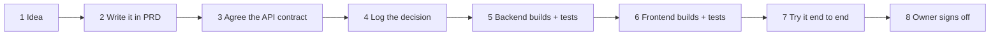

# QuantGen — How We Work (plain-language guide)

**Read this first if you're new.** No banking or Spring knowledge needed. It tells you who
does what, where to find things, how an idea becomes a shipped feature, and how to ask for
something. When this page and another doc disagree, the other doc wins:
[`PRD.md`](PRD.md) for *what* we build, [`ARCHITECTURE.md`](ARCHITECTURE.md) for *how*,
[`DECISIONS.md`](DECISIONS.md) for *why*, [`CLAUDE.md`](CLAUDE.md) for the rules.

---

## 1. QuantGen in one minute
QuantGen is a **pretend bank you can actually use**: open accounts, add money, send money,
buy simulated stocks, take a loan, and (in v2) let an AI assistant help you, all with **no
real money involved**. It's built like a real bank underneath, so the rules about money are
strict.

```
 You (browser)  ──▶  Website (React)  ──▶  Server (Spring Boot)  ──▶  Database (PostgreSQL)
                                              │
                                              └─(v2)─▶ AI service (agent-quant) ──▶ Claude
```

## 2. Who's who
| Who | What they do | Folder they own |
|---|---|---|
| **Owner** (Pritish) | Decides scope, approves milestones and contract changes, pushes to GitHub | everything, final say |
| **Backend session** (a Claude session) | The server: accounts, ledger, payments, trading, loans, Autopilot, proofs | `backend-quant/` |
| **Frontend session** | The website, plus Docker/CI/deploy files | `frontend-quant/`, root `docker-compose.yml`, `.github/`, later `deploy/` |
| **Agent session** (new in v2) | The AI service: copilot, specialist agents, MCP server | `agent-quant/` |
| **Shared** | Anyone may edit, carefully | `PRD.md`, `ARCHITECTURE.md`, `DECISIONS.md`, `FLOW.md`, `CLAUDE.md` |

**The one rule everyone forgets:** *never edit a folder you don't own.* Ask the owner of that
folder instead (§5 shows how).

## 3. Where do I find…?
| I want to know… | Look in |
|---|---|
| What a feature should do | `PRD.md` §5 (v1) or §11 (v2) |
| The exact URL, fields and errors of an API | `PRD.md` §7 (v1) or §12 (v2 draft) |
| How the ledger or login works inside | `ARCHITECTURE.md` |
| Why we chose X over Y | `DECISIONS.md` |
| The rules for touching money and security | `CLAUDE.md` |
| How to run the backend | `backend-quant/Setup.md`, `README.md` |
| How the website looks and behaves | `frontend-quant/DESIGN.md`, `frontend-quant/CLAUDE.md` |
| What the frontend asked the backend for | `frontend-quant/HANDOFF.md` |
| What to click to test every feature | `QA_CHECKLIST.md` |
| Live API docs (when the server runs) | <http://localhost:8080/swagger-ui.html> |

## 4. How a feature travels from idea to done

1. **Idea.** Anyone can suggest one. Say it to the owner in one or two sentences.
2. **Write it in the PRD.** Add a requirement with an id (e.g. `F-PAY-14`) and a priority.
   *Rule of thumb:* if you can't explain it in three bullet points, split it.
3. **Agree the API contract.** Add the URL, request, response and error codes to PRD §7/§12.
   Both the backend and frontend sessions must be happy with it *before* coding.
4. **Log the decision** in `DECISIONS.md` if you chose between real options. Always write the trade-off.
5. **Backend builds it** with tests, including concurrency and idempotency tests for anything
   that moves money, then tells the frontend "endpoint X is live".
6. **Frontend builds it** against the contract (it can start earlier using mocks).
7. **Try it end to end** on the real stack (`docker compose up`) and add steps to `QA_CHECKLIST.md`.
8. **Owner signs off.** Only then is the milestone "done". Commits are local; the owner pushes.

## 5. How to talk to each other
**Fastest:** sessions message each other directly (`ListAgents` → `SendMessage`).
**If that fails:** write a dated note in your own folder's `HANDOFF.md` and tell the owner.
**For decisions:** `DECISIONS.md`. **For scope:** `PRD.md`. Chat history is *not* a record:
anything important must end up in a file.

Copy-paste templates:

**Asking for a feature or endpoint**
```
To: backend session
What: I need GET /api/v1/insights/spending for the Insights page (PRD F-INS-1, §12.5).
Why: the dashboard shows spend by category.
By when: blocks frontend V2-M3 work.
Questions: should groupBy=month return the last 12 months only?
```

**Changing the API contract**
```
To: frontend session
Change: TransferDto.status gains "PENDING_REVIEW" (PRD §12.2, already edited).
Why: fraud review (F-RISK-1) holds suspicious transfers.
Impact on you: show a "Under review" badge; treat unknown statuses gracefully.
Backward compatible: yes (additive).
```

**Reporting a bug**
```
What happened: transfer of ₹1,500 showed an error toast but the money left.
Expected: either success, or no money moved.
Steps: login demo → Transfer → ₹1,500 to 1234… → double-click Send.
Evidence: request id b3c1… (from the error body), screenshot.
Severity: money bug (highest).
```

**Handing off at the end of a session** (in your `HANDOFF.md`)
```
## 2026-MM-DD
Done: …   In progress: …   Blocked on: …   Contract changes: …   Next step: …
```

**Severity words we use:** *money bug* (balances could be wrong: stop everything) ·
*security bug* (someone could see or do what they shouldn't: tell the owner immediately) ·
*broken* (a feature doesn't work) · *polish* (it works but could be nicer).

## 6. What actually happens when… (the important flows)

### …you click "Send money" (v1)
1. The website shows **fill in → review → confirm**. Nothing moves until you confirm.
2. It sends the request with a random **Idempotency-Key**, a "this is request #abc" tag. If
   your Wi-Fi drops and it retries, the server sees the same tag and won't send twice.
3. The server checks: is this your account? Is it frozen? Under the limits? Enough money?
4. The **ledger** writes two lines, *minus ₹1,500 from you* and *plus ₹1,500 to them*, in one
   go. Either both lines are saved or neither is. Money is never created or lost.
5. The website shows the new balance **only after** the server says it worked. It never guesses.

### …you ask the AI assistant to pay someone (v2)
1. You type "pay Aarav ₹500 for dinner".
2. The assistant (several AI agents working together) figures out who Aarav is and **proposes**
   a payment. It cannot pay by itself, ever.
3. You see an approval card written by **the server** (not the AI) showing exactly who gets
   how much. You tap Approve (and confirm with your fingerprint/passkey for large amounts).
4. Only now does the normal "send money" flow above run.

### …you set up an Autopilot rule (v2, signature feature)
1. You type: "When my salary arrives, move 20% to my Goa goal."
2. The AI turns that into a precise rule. The server rewrites it back into a plain sentence so you
   can check it says what you meant.
3. The server **replays the rule over your last 90 days** ("this would have run 3 times and moved ₹36,000").
4. You approve once. From then on a plain program (no AI) runs it every time salary arrives,
   within the caps you set.

### …you verify your balance (v2, signature feature)
Every night the bank publishes one fingerprint (a "root hash") of everyone's balances. You click
**Verify**, your browser downloads your little piece of the puzzle and checks the maths itself.
A green tick means your balance is really included and history wasn't secretly edited.

## 7. Golden rules (plain-English version of `CLAUDE.md`)
1. **Only the ledger changes balances.** No shortcut, no "just update the number".
2. **Money is text, not a number,** in JSON and in the browser (`"1250.50"`), so no rounding errors.
3. **Every money action carries an Idempotency-Key.** Retries reuse it.
4. **Never show a balance before the server confirms it.**
5. **Someone else's stuff looks like it doesn't exist** (`404`), so nobody can probe ids.
6. **AI proposes, humans approve.** No AI output moves money on its own.
7. **Never log or commit secrets,** passwords, tokens, PINs, full account numbers or card numbers.
8. **Every feature ships with tests.** Money features need concurrency and retry tests too.
9. **The API contract in the PRD is the law.** Change it first, tell the other side, then code.
10. **Not sure about money or security? Stop and ask.** Guessing is the only wrong answer.

## 8. Running it on your machine
Needs Docker Desktop running, JDK 25 and Node 24 (versions in `CLAUDE.md`).
```bash
docker compose -f docker-compose.dev.yml up -d                      # database on :5433
cd backend-quant && ./mvnw spring-boot:run -Dspring-boot.run.profiles=dev   # server on :8080
cd frontend-quant && npm run dev                                    # website on :5173
```
Log in with `demo@quantgen.dev / Demo@1234` (customer) or `admin@quantgen.dev / Admin@1234` (admin).
Website only, no server: `cd frontend-quant && npm run dev:mock`.
Whole production-like stack: `docker compose up -d --build` → <http://localhost:8088>.

Tests: `cd backend-quant && ./mvnw verify` · `cd frontend-quant && npm run lint && npm test`.

> ⚠️ Port 5432 belongs to another PostgreSQL on this machine. Ours is **5433**. Leave 5432 alone.

## 9. "Done" checklist (copy into your PR or commit message)
- [ ] Matches the PRD requirement and the API contract exactly (paths, fields, errors)
- [ ] Answered the five "think before you code" questions (`CLAUDE.md`) for money/auth/personal data
- [ ] Tests added and passing (money: + concurrency + idempotency)
- [ ] Tried it for real, not only in tests
- [ ] No secrets, no full account numbers in logs
- [ ] Docs updated (PRD / ARCHITECTURE / DECISIONS / QA_CHECKLIST) if behaviour or design changed
- [ ] Committed only my own folder, with explicit paths: `git commit -m "backend: …" -- backend-quant/`

## 10. Glossary
| Word | Meaning |
|---|---|
| **Ledger** | The bank's notebook of every money movement. Lines are only ever added, never changed. |
| **Double-entry** | Every movement is written twice, a minus somewhere and a plus somewhere, so they always add up to zero. |
| **Journal entry / ledger line** | One movement (entry) and its minus/plus rows (lines). |
| **System account** | The bank's own pots, e.g. `BANK_CASH` (money coming in from outside), `LOAN_RECEIVABLE` (money people owe). |
| **Idempotency-Key** | A unique tag on a money request so a retry can't charge twice. |
| **Reconcile** | A check that every cached balance equals the sum of its ledger lines. |
| **Hold** (v2) | Money set aside but not yet moved (e.g. a card payment waiting to complete). Shows as "available" being lower than "balance". |
| **Step-up** (v2) | A second check (fingerprint, passkey or PIN) before a risky action. |
| **Passkey** (v2) | Passwordless login with your device's fingerprint or face unlock. |
| **Handle** (v2) | Your pay-me name, like `pritish@qg`. |
| **Intent** (v2) | An action the AI *suggests* and you must approve. |
| **Agent** (v2) | An AI worker with one job and a small set of allowed tools. |
| **Orchestrator / Concierge** (v2) | The AI agent that talks to you and hands work to specialist agents. |
| **Autopilot rule** (v2) | A money rule you approve once, run by a plain program, not the AI. |
| **Outbox** (v2) | A table where every money movement leaves a note, so other parts of the system can react reliably. |
| **Hash chain / Merkle tree** (v2) | Maths that makes any secret edit to history detectable, and lets you check your balance is included in the bank's total. |
| **Contract** | The exact API agreement in the PRD between server and website. |
| **Milestone** | A numbered chunk of work (M0–M6 for v1, V2-M0–V2-M11 for v2) that ends with a demo and sign-off. |
| **Session** | One Claude Code conversation that owns one folder. |

## 11. I'm stuck — what now?
- **The website shows an error.** Every error carries a `requestId`. Search the server logs for it.
- **"Port already in use".** Something else is on 8080/5173/5433. Stop it; never touch 5432.
- **Integration tests fail to start.** Docker Desktop isn't running (tests start their own Postgres).
- **I need something from another folder.** Message that session (§5). Don't edit it yourself.
- **The PRD doesn't say what to do.** Ask the owner, then write the answer into the PRD so the next person doesn't have to ask.
- **I found a security problem.** Tell the owner right away, even if it's not your task.
